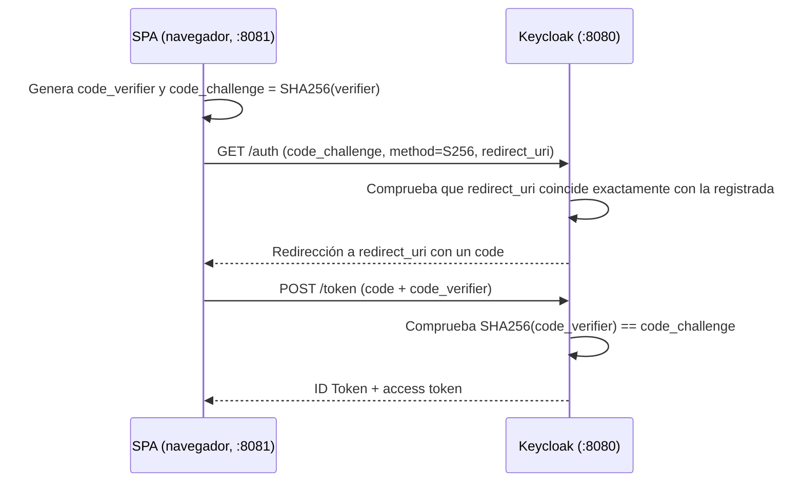
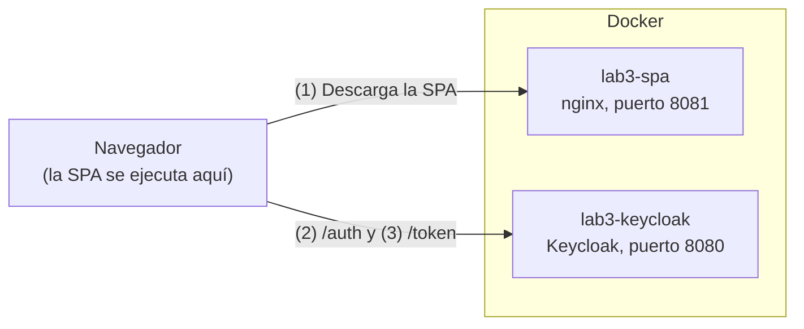

<br/><br/>


# Laboratorio 3: Autorización delegada en una SPA con OpenID Connect y PKCE

*Curso de Identidad Digital, Autenticación y Autorización — Módulo 3: Federación, JWT y autenticación
en microservicios.*

## Objetivos

Las aplicaciones web modernas rara vez gestionan ellas mismas las contraseñas de sus usuarios. En su
lugar, delegan la autenticación en un servidor especializado y reciben de él unos *tokens* que
acreditan quién es el usuario y qué se le permite hacer. Los protocolos que estandarizan esa
delegación son **OAuth 2.1**, para la autorización, y **OpenID Connect** (OIDC), que se construye
sobre él para la autenticación. Su flujo central para aplicaciones que se ejecutan en el navegador se
refuerza con una extensión llamada **PKCE**. Esta práctica consiste en observar ese flujo en
funcionamiento, inspeccionando con la pestaña de red del navegador cada una de las peticiones que lo
componen.

Al finalizar la práctica, el estudiante será capaz de:

- Describir el flujo *Authorization Code* de OAuth 2.1 y el papel de cada petición.
- Explicar qué problema resuelve PKCE y por qué un código de autorización interceptado resulta inútil
  sin la prueba asociada.
- Registrar un cliente público en Keycloak, con URIs de redirección exactas, y configurarlo para
  exigir PKCE.
- Distinguir el **ID Token** del **access token** e interpretar los *claims* que indican a quién va
  dirigido cada uno.

## Dependencias

Para realizar la práctica, el alumno deberá tener instalado en su ordenador:

- **Docker** y **Docker Compose** ([instalación](https://docs.docker.com/get-docker/)).
- Los puertos **8080**, **9000** y **8081** libres. Si el Keycloak de un laboratorio anterior sigue
  en marcha, deténgalo antes, ejecutando `docker compose down` en la carpeta de aquel laboratorio.
- Las herramientas de línea de órdenes `openssl` y `curl`, presentes en cualquier distribución de
  Linux.
- Cualquier navegador moderno (Chrome, Edge, Chromium o Firefox).

La práctica es independiente de los laboratorios anteriores y no necesita conexión a internet: el
entorno arranca con todo lo necesario ya incluido.

## Descripción de la práctica

La aplicación de esta práctica es una **SPA** (*Single Page Application*): una página que se ejecuta
íntegramente en el navegador. Su particularidad es que realiza ella misma todo el diálogo con el
servidor de identidad y, por tanto, los *tokens* acaban residiendo en el propio navegador. Conviene
advertirlo desde el principio: **este no es el patrón recomendado para producción**, porque expone
los *tokens* a cualquier vulnerabilidad de la página. Se monta así deliberadamente, con fines
didácticos, para ver el mecanismo en su forma más desnuda; el siguiente laboratorio presentará la
alternativa correcta.

El protocolo que gobierna el intercambio es **OAuth 2.1**, cuya versión más reciente elimina los
flujos considerados inseguros y exige el uso de **PKCE** (*Proof Key for Code Exchange*). La mecánica
es la siguiente. Antes de empezar, la aplicación genera un valor secreto y aleatorio, el
`code_verifier`, y calcula su "huella" criptográfica, el `code_challenge`, como el resultado de
aplicar SHA-256 al verifier. La aplicación envía al servidor únicamente el *challenge*; el servidor
lo guarda y devuelve un código de autorización (`code`). Para canjear ese código por los *tokens*, la
aplicación debe presentar ahora el `code_verifier` original, y el servidor comprueba que su huella
coincide con el *challenge* que guardó. De este modo, aunque un atacante intercepte el `code`, no
podrá canjearlo: le falta el verifier, que nunca viajó por la red hasta el último paso.

Como la aplicación pide además el *scope* `openid`, el servidor no devuelve un único *token*, sino
dos. El **access token** es el de OAuth: sirve para llamar a una API en nombre del usuario. El **ID
Token** es el que añade OpenID Connect: le dice a la propia aplicación quién es el usuario que acaba
de autenticarse. El flujo completo es el siguiente:



La infraestructura es mínima: dos contenedores. Uno, `lab3-spa`, sirve la SPA como página estática
mediante `nginx`, sin compilación ni Node. El otro, `lab3-keycloak`, ejecuta Keycloak como servidor
de identidad. La librería con la que la SPA habla con Keycloak (`keycloak-js`) viene incluida en el
propio laboratorio, de modo que no se descarga de internet.



Conviene fijarse en un detalle, porque explica buena parte de la práctica: **`nginx` no interviene
en el inicio de sesión**. Solo entrega al navegador los ficheros de la SPA (1); a partir de ahí, la
SPA se ejecuta en el navegador y habla directamente con Keycloak (2 y 3). Por eso los *tokens*
terminan en el navegador, y por eso Keycloak tiene que autorizar expresamente al origen
`http://localhost:8081` a hacerle peticiones (el ajuste *Web origins* del apartado 2, que el
navegador exige por la política de CORS).

---

## 1. Puesta en marcha

El fichero `docker-compose.yml` arranca dos servicios: Keycloak en modo de desarrollo, que **importa
al arrancar** el fichero `realm/realm-curso.json`, y un `nginx` que sirve la SPA de la carpeta `spa/`.
El fichero importado crea un realm `curso` con un único usuario, `diego` (contraseña `diego`). Para
iniciarlo, copie el fichero de configuración y levante los contenedores:

```bash
cp .env.example .env
docker compose up -d
```

Espere a que Keycloak indique `healthy` en la columna de estado:

```bash
docker compose ps
```

A continuación, confirme que ambos servicios responden:

- Keycloak: `http://localhost:8080/` (consola de administración, credenciales `admin` / `admin`).
- La SPA: `http://localhost:8081/`, que debe mostrar el texto "No autenticado." y un botón "Iniciar
  sesión".

---

## 2. Registro del cliente público y activación de PKCE

Toda aplicación que quiera delegar la autenticación en Keycloak debe estar registrada en él como
*cliente*. Keycloak distingue dos tipos. Un cliente **confidencial** puede guardar un secreto porque
se ejecuta en un servidor controlado; un cliente **público**, como esta SPA, no puede, porque su
código es visible para cualquiera que abra las DevTools. Precisamente porque no puede guardar un
secreto, el cliente público se protege con PKCE.

Hay un segundo aspecto igual de importante: las **URIs de redirección**. Tras el inicio de sesión,
Keycloak devuelve el `code` a la dirección que indique la aplicación en el parámetro `redirect_uri`,
pero solo si esa dirección figura en la lista registrada para el cliente. OAuth 2.1 exige que la
comparación sea **exacta**, carácter a carácter, sin comodines.

1. Consola de administración → realm `curso` → **Clients** → **Create client**.
   - Client ID = `spa-curso` → Next.
   - **Client authentication = OFF** (público), **Standard flow = ON**, el resto OFF → Next.
   - **Valid redirect URIs**: añada estas dos direcciones, exactamente así (con el botón para añadir
     una segunda línea):
     - `http://localhost:8081/`
     - `http://localhost:8081/capturar-code.html`
   - **Valid post logout redirect URIs** = `http://localhost:8081/`
   - **Web origins** = `http://localhost:8081` → Save.
2. Abra el cliente `spa-curso` → pestaña **Advanced** → **Proof Key for Code Exchange Code Challenge
   Method** → `S256` → Save.

> **Pregunta 2.1.** ¿Por qué este cliente se declara **público** y no incorpora un secreto, como sí harán
> otros clientes?

---

## 3. Inicio de sesión con la pestaña de red abierta

El objetivo de este apartado es observar el intercambio paso a paso.

1. Abra `http://localhost:8081/` → DevTools (F12) → pestaña **Network** (en Firefox, **Red**) →
   marque **Preserve log** (en Firefox, **Persist Logs**, en el menú de engranaje de la pestaña).
   Esta última opción es imprescindible: sin ella, las redirecciones del flujo borrarían las
   peticiones anteriores y no se vería la secuencia completa.
2. Pulse **"Iniciar sesión"** y siga, en la pestaña de red, las peticiones que se van produciendo:
   - Una petición **GET** a `.../openid-connect/auth` que incluye los parámetros `code_challenge`,
     `code_challenge_method=S256` y `redirect_uri=http://localhost:8081/`. Anote el valor del
     `code_challenge`: se necesitará en el apartado 5.
   - Inicie sesión como `diego` (contraseña `diego`). Aparecerá también un POST a
     `.../authenticate`, que corresponde al envío del formulario de la propia pantalla de Keycloak;
     no forma parte del intercambio OAuth y puede ignorarse.
   - El navegador regresa a la SPA. El `code` llega en el *fragmento* de la URL (la parte tras `#`),
     que por diseño no se envía al servidor; por eso no figura como una petición de red, sino que lo
     lee la propia página mediante JavaScript.
   - Una petición **POST** a `.../openid-connect/token` que lleva en el cuerpo el `code`, el
     `code_verifier` y el `client_id`. Esta es la petición clave del flujo; localícela y anote el
     `code_verifier`, que también se necesitará en el apartado 5.
3. La página muestra ahora los dos *tokens* recibidos, el **ID Token** y el **access token**, cada uno
   en crudo y con sus *claims* ya decodificados.

Los *tokens* están ahora en la página, al alcance de su JavaScript. Para comprobar hasta qué punto,
abra la pestaña **Console** de las DevTools y escriba:

```js
document.querySelector("#access-token").textContent
```

La consola devuelve el access token completo. Cualquier código JavaScript que se ejecute en esta
página podría hacer exactamente lo mismo.

> **Pregunta 3.1.** La teoría del módulo advierte de que tener los *tokens* en el navegador es
> peligroso. A la vista de lo que se acaba de hacer en la consola, ¿por qué exactamente?

---

## 4. Dos tokens con destinatarios distintos

Compare los *claims* de los dos *tokens* que muestra la página. Ambos los ha emitido el mismo servidor
(`iss`) para el mismo usuario (`sub`), pero no son iguales. Fíjese en particular en:

- `typ`: el tipo de *token* (`ID` en uno, `Bearer` en el otro).
- `aud` (*audience*): el destinatario al que va dirigido cada *token*.
- `azp` (*authorized party*): el cliente que lo solicitó.
- Los datos personales de Diego (`name`, `email`, `preferred_username`…). Proceden de los *scopes*
  `profile` y `email`, que Keycloak concede por defecto a todo cliente nuevo; el claim `scope` del
  access token muestra cuáles se han concedido.

> **Pregunta 4.1.** El ID Token y el access token tienen distinto `aud`. ¿A quién va dirigido cada uno y
> para qué sirve? ¿Qué debería hacer una API si recibiera un ID Token en lugar de un access token?

---

## 5. Comprobación criptográfica manual

Este es el único punto de todo el curso en el que se manipula criptografía a mano, y apenas lleva un
par de minutos. Con el `code_challenge` (de la petición a `/auth`) y el `code_verifier` (de la
petición a `/token`) anotados en el apartado 3, calcule la huella SHA-256 del verifier:

```bash
printf '%s' 'EL_CODE_VERIFIER_DE_LA_PETICION' | openssl dgst -binary -sha256 | openssl base64 -A \
  | tr '+/' '-_' | tr -d '='
```

El resultado debe coincidir **exactamente** con el `code_challenge` que viajó en la petición a
`/auth`. Esta comprobación demuestra que el *challenge* no es un valor arbitrario, sino la huella
verificable del verifier: es la prueba de que quien reclama los *tokens* es el mismo que inició el
proceso, y nadie más.

> **Pregunta 5.1.** El `code_challenge` viaja por la red en la primera petición, a la vista de cualquiera
> que pueda observarla. ¿Por qué no le sirve a un atacante para obtener el `code_verifier`?

---

## 6. Verificación: un código interceptado

Se trata ahora de demostrar, de forma práctica, que un `code` interceptado no sirve de nada sin el
`code_verifier` exacto. Como el código del inicio de sesión legítimo ya se consumió (un `code` solo
puede canjearse una vez), hay que generar códigos nuevos y dirigirlos a una página que no los consuma
automáticamente: `capturar-code.html`, una página en blanco registrada en el apartado 2.

Para obtener un `code` nuevo, construya la siguiente URL (sustituyendo `CODE_CHALLENGE` por el valor
anotado) y ábrala en el navegador:

```
http://localhost:8080/realms/curso/protocol/openid-connect/auth?client_id=spa-curso&redirect_uri=http://localhost:8081/capturar-code.html&response_type=code&scope=openid&code_challenge=CODE_CHALLENGE&code_challenge_method=S256
```

Como Diego ya tiene una sesión activa, se aterriza directamente en `capturar-code.html` con un `code`
nuevo en la barra de direcciones (el valor que sigue a `code=`). Cada `code` caduca en
aproximadamente **un minuto**, así que conviene tener preparada la orden de `curl` antes de abrir la
URL.

Realice los tres intentos siguientes. **Cada uno necesita un `code` nuevo**: vuelva a abrir la misma
URL antes de cada intento.

1. **Sin verifier**, como lo intentaría un atacante que solo hubiera interceptado el `code`:
   ```bash
   curl -s -X POST http://localhost:8080/realms/curso/protocol/openid-connect/token \
     -H "Content-Type: application/x-www-form-urlencoded" \
     -d "grant_type=authorization_code" \
     -d "client_id=spa-curso" \
     -d "code=PEGAR_AQUI_EL_CODE" \
     -d "redirect_uri=http://localhost:8081/capturar-code.html"
   ```
   Keycloak lo rechaza: `invalid_grant`, `PKCE code verifier not specified`.
2. **Con un verifier alterado**: repita la orden añadiendo
   `-d "code_verifier=..."` con el verifier anotado, pero **cambiando un solo carácter**. Keycloak lo
   rechaza de nuevo, esta vez con `PKCE verification failed: Code mismatch`.
3. **Con el verifier correcto**: repita la orden con el `code_verifier` exacto. Esta vez Keycloak
   devuelve los *tokens*, lo que confirma que los rechazos anteriores se debían exactamente al
   verifier y no a ninguna otra causa.

Si en el segundo o el tercer intento se reutiliza el `code` del intento anterior, Keycloak responde
`Code not valid`, aunque el verifier sea el correcto.

> **Pregunta 6.1.** Tras un intento fallido, el mismo `code` ya no sirve ni siquiera con el verifier
> correcto. ¿Por qué invalida Keycloak el `code` aunque el canje haya fallado? ¿Qué le impediría a un
> atacante esta decisión?

---

## 7. Verificación: la URI de redirección exacta

Por último, se comprueba que la lista de URIs de redirección se aplica de forma estricta.

1. Cierre la sesión en la SPA (botón **Cerrar sesión**).
2. Abra la SPA con una dirección ligeramente distinta: `http://localhost:8081/index.html`. Es la
   misma página, servida por el mismo `nginx`.
3. Pulse **"Iniciar sesión"**. Keycloak no muestra el formulario, sino un error: `Invalid parameter:
   redirect_uri`. La SPA ha pedido volver a `http://localhost:8081/index.html`, que no figura
   exactamente en la lista registrada.

> **Pregunta 7.1.** Supóngase que, por comodidad, se hubiera registrado `http://localhost:8081/*` como
> URI de redirección válida. ¿Qué riesgo supone un comodín así, y por qué OAuth 2.1 exige la
> comparación exacta?

---

## Resolución de problemas

- Las peticiones desaparecen de la pestaña de red tras una redirección → no se marcó **Preserve log**
  (**Persist Logs** en Firefox). Repita el inicio de sesión con la opción activada.
- La petición a `/token` falla con un error de CORS → revise el campo **Web origins** del cliente,
  que debe ser `http://localhost:8081`.
- Al pulsar "Iniciar sesión" desde `http://localhost:8081/`, Keycloak responde `Invalid parameter:
  redirect_uri` → revise que las URIs del apartado 2 se escribieron exactamente igual, incluida la
  barra final.
- El canje con `curl` responde `Code not valid` → el `code` ya se había usado o ha caducado. Vuelva a
  abrir la URL del apartado 6 para obtener uno nuevo y repita el intento sin demora.
- `docker compose up` falla porque algún puerto está ocupado → el Keycloak de un laboratorio anterior
  sigue en marcha. Deténgalo con `docker compose down` en la carpeta de aquel laboratorio.
- Para reiniciar el entorno desde cero (se pierde el cliente creado y el realm se vuelve a importar):
  `docker compose down -v && docker compose up -d`.
